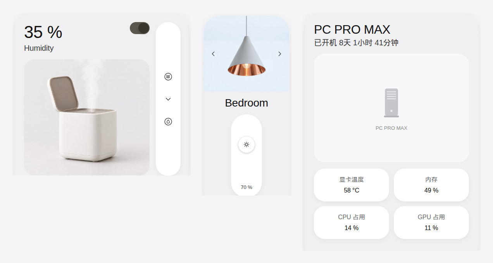

# VHA

VHA 是一套面向 Home Assistant 的 Lovelace **自定义卡片**（HACS 类型：Dashboard）。

当前提供一张**设备卡**（`custom:vha-device-card`）。同一类型有三种排版：大图设备、竖图滑杆、电子设备模块。视觉对齐 [设计规范 1.0](docs/design-spec-1.0.md)。

- 只需在仪表盘视图里添加卡片，**不必改 `configuration.yaml`**
- **不会**注册自定义侧边栏面板，HA 原有菜单、顶栏、侧边栏保持原样
- 开关、滑杆和模式按钮会对真实实体调用服务（`light` / `switch` / `fan` / `humidifier` / `cover` / `lock` 等常见域）

后续会按同一套风格继续补其他类型的卡片。



## 开发规划

九张卡片的目标、现有仪表盘怎么归并、交互和界面要求见 [插件开发规划](docs/plugin-development.md)。第一批卡片的视觉语言见 [设计规范 1.0](docs/design-spec-1.0.md)。

- [文档索引](docs/README.md)
- [设计规范 1.0](docs/design-spec-1.0.md)
- [卡片审核与发布标准](docs/card-review-standard.md)

## 用 HACS 安装

需要已安装 [HACS](https://hacs.xyz/) 的 Home Assistant（建议 2024.4 或更新）。

1. 打开 **HACS**。
2. 右上角 **⋮ → Custom repositories**（自定义仓库）。
3. 仓库地址填：

   `https://github.com/Virus0418/VHA`

   类型选择 **Dashboard**。
4. 添加后，在 HACS 里搜索 **VHA**，打开并 **Download**（下载）。
5. 按提示 **刷新浏览器**（或 Ctrl/Cmd + F5）。

HACS 会把卡片模块登记为仪表盘资源，通常路径是：

`/hacsfiles/VHA/vha.js`

（对应文件在 Home Assistant 里是 `/config/www/community/VHA/vha.js`。）

若你的仪表盘资源使用 YAML 模式，HACS 可能不会自动写入资源。请到 **设置 → 仪表盘 → ⋮ → 资源**，添加 JavaScript 模块，URL 填 `/hacsfiles/VHA/vha.js`，然后再刷新浏览器。

## 在视图里添加卡片

1. 打开任意 Lovelace 仪表盘，点右上角铅笔进入编辑。
2. 在目标视图中点 **添加卡片**。
3. 搜索 **VHA 设备卡**，或选「手动」后填写下面的 YAML。
4. 在可视化编辑器里选择 **实体** 和 **排版形式**。大图可填名称、型号、状态和动作；电子设备可开关产品图、电源、电池、网络、位置和指标。
5. 保存。

大图示例（省略 `layout` 时也是大图，旧配置可以不改）：

```yaml
type: custom:vha-device-card
entity: humidifier.bedroom
name: 卧室加湿
status: Humidity
show_toggle: true
```

竖图与电子设备的字段、模块开关和窄栏行为见 [设备卡说明](docs/cards/vha-device-card.md)。

## 配置项

| 选项 | 必填 | 说明 |
| --- | --- | --- |
| `entity` | 是 | Home Assistant 实体 ID |
| `layout` | 否 | `large` 大图、`vertical` 竖图、`electronics` 电子设备。省略为 `large` |
| `name` | 否 | 标题，默认用实体友好名称 |
| `model` | 否 | 副标题 / 型号 |
| `status` | 否 | 大图的说明文案，留空则自动 |
| `image` | 否 | 图片 URL；留空则使用 `entity_picture` |
| `show_toggle` | 否 | 大图是否显示电源开关，默认显示 |

电源开关、滑杆和模式按钮调用对应服务，例如 `light.turn_on` / `turn_off`、`humidifier.set_mode`、`lock.lock` / `unlock`。点击标题或产品图打开该实体的「更多信息」；开关和滑杆不会误开。不可用时显示「不可用」并禁用写入。服务失败时卡片上留一句短错误。

## 手动安装（不用 HACS）

1. 下载仓库根目录的 [`vha.js`](./vha.js)。
2. 复制到 `/config/www/vha/vha.js`。
3. **设置 → 仪表盘 → ⋮ → 资源**，添加 JavaScript 模块：`/local/vha/vha.js`。
4. 刷新浏览器，然后按上面的步骤添加卡片。

## 本地预览与构建

```bash
npm install
npm run dev
```

浏览器打开终端里的地址（默认 http://localhost:4174）可预览设备卡，不需要 Home Assistant。

```bash
npm run build
```

会生成 `release/vha.js`，并应复制为仓库根目录的 `vha.js`（HACS 在没有 Release 资源时会在仓库根目录或 `dist/` 下查找该文件）。

## 许可

MIT
